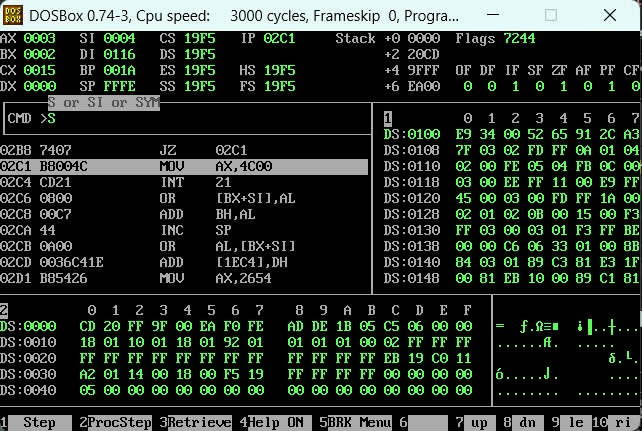
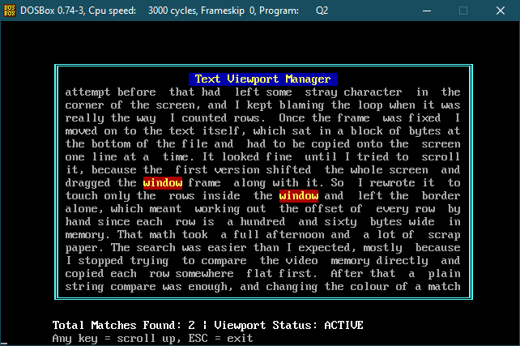
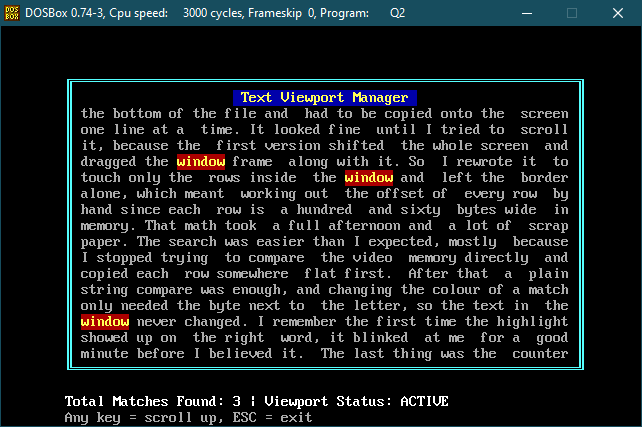

# COAL Assembly Programs

**Name:** Rana Zaid
**Roll no:** 25L-0681

All my COAL / 8088 Assembly Language assignments live in this repo, one folder per assignment.

## Programs

### Assignment2: Q4 Observation Classifier

A 16 bit 8088 program that classifies network observations as Normal, Suspicious or Attack using a small weighted scoring model.

- Each observation is one packed 16 bit word holding three features: 6 bits of connection rate (X1), 5 bits of failed attempts (X2) and 5 bits of payload entropy (X3). Every feature is pulled out with masks and shifts, then shifted down by an offset so it can go negative.
- Each class has its own weights W1, W2, W3 and a bias. The score is `X1*W1 + X2*W2 + X3*W3 + bias`, calculated with signed multiplication handled by hand (sign check, `MUL`, then fix the sign).
- The class with the highest score wins, and the result is stored per observation in `predFlag` (1 = Normal, 2 = Suspicious, 3 = Attack).
- The program loops over all observations in the `obs` table.

### Assignment3: Q2 Text Viewport Manager with Windowed Scrolling and Live Keyword Highlighter

A 16 bit 8088 program that builds a text viewer straight into video memory (0xB800).

- Clears the 80 x 25 screen and draws a double line border window (rows 3 to 21, columns 8 to 72) with a centered title banner in yellow on blue.
- Streams a 20 line document into the window with LODSB / STOSW, keeping a 2 column margin on both sides.
- `scroll_window_up` shifts only the text inside the window up by N lines using MOVSW row by row, then blanks the vacated rows with STOSW. The border and the rest of the screen are never touched.
- `find_and_highlight` goes through the window row by row, matches the keyword with REPE CMPSB, and rewrites only the attribute bytes of every hit (0xCE, blinking yellow on red). The characters themselves stay as they are.
- Row 23 shows the status bar: `Total Matches Found: [Count] | Viewport Status: ACTIVE`, with the count printed by a stack based `printNum`.
- Every procedure takes its parameters on the stack, uses `[bp + offset]` for access, keeps its locals at `[bp - offset]`, preserves the registers it changes and cleans up with `ret n`.

The program waits for a keypress before scrolling, so you can see the window both before and after.

## Tools used

- NASM (assembler)
- DOSBox (to run the .COM files)

## How to assemble and run

Assignment 2:

```
nasm q4.asm -o q4.com
```

Assignment 3:

```
nasm q2.asm -o q2.com
```

Then in DOSBox (swap the folder and file name for the other assignment):

```
mount c path\to\COAL\Assignment3
c:
q2.com
```

For Assignment 3, press any key once to scroll, and once more to exit.

## Folder structure

```
COAL/
├── README.md
├── Assignment2/
│   ├── q4.asm
│   └── screenshots/
│       └── q4_output.png
└── Assignment3/
    ├── q2.asm
    └── screenshots/
        ├── before_scroll.png
        └── after_scroll.png
```

## Output screenshots

### Assignment 2



### Assignment 3

Before scrolling:



After scrolling:


